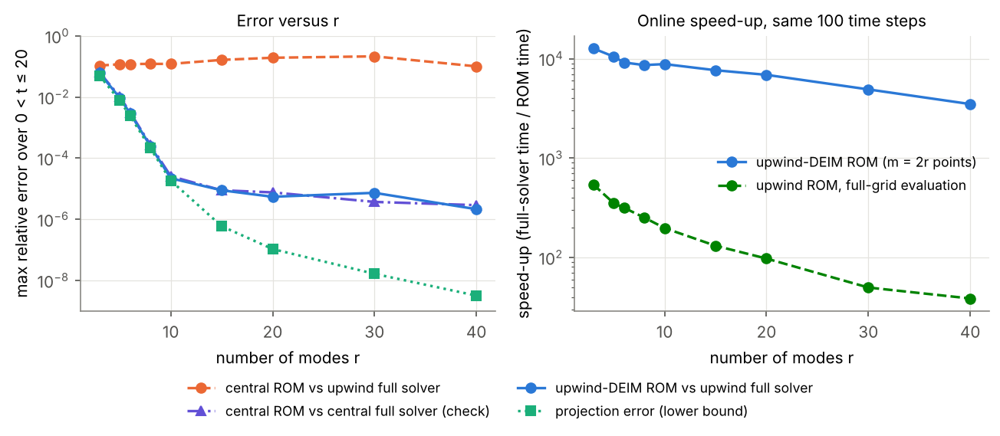
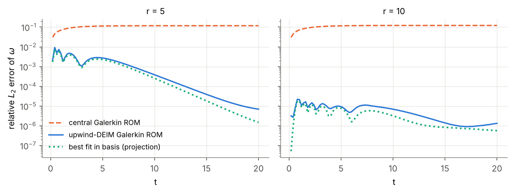
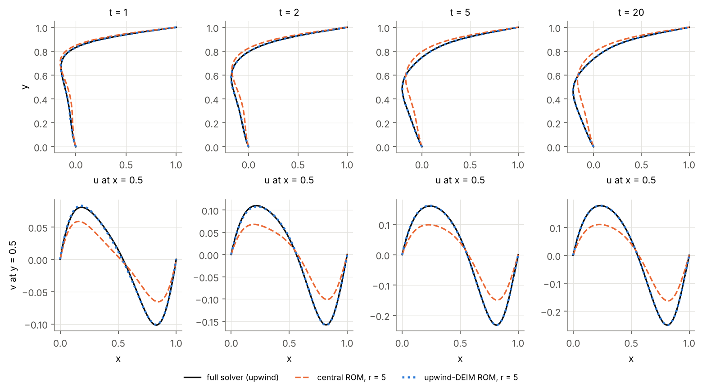
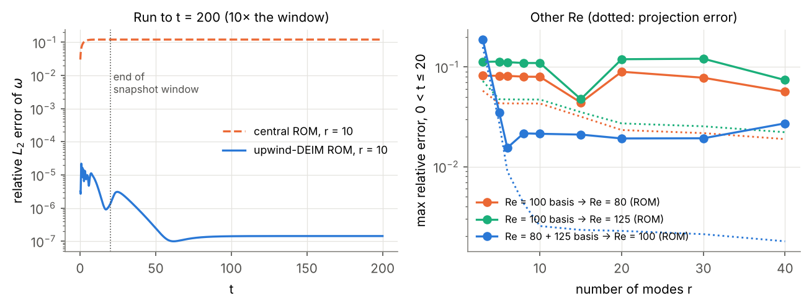
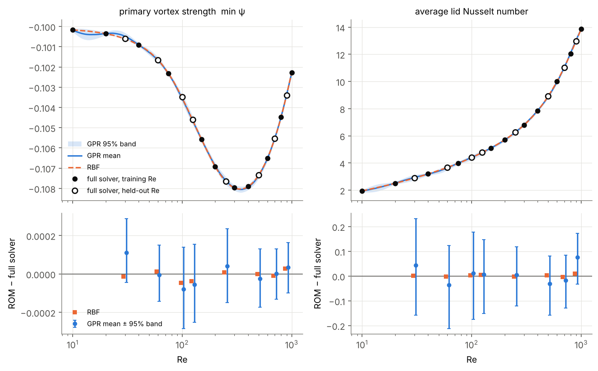
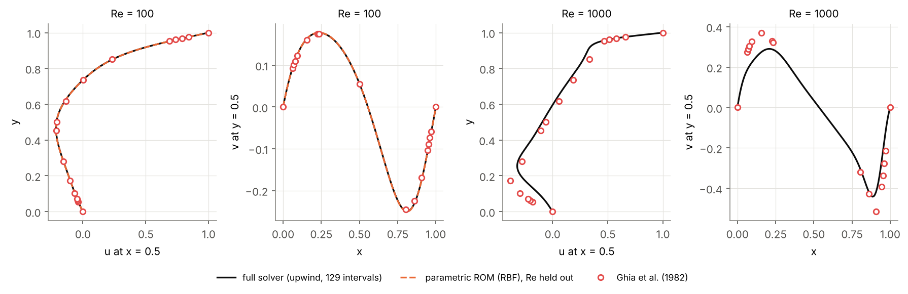
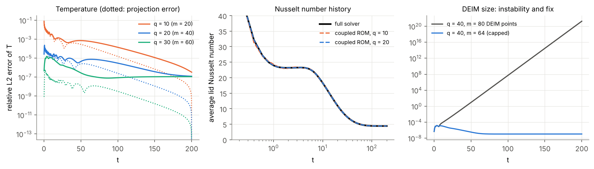

# POD reduced-order models of the lid-driven cavity

This repository builds reduced-order models (ROMs) of my stream function–vorticity
finite-difference solver for the lid-driven cavity. It has three parts:

1. **Intrusive POD-Galerkin ROM** of the transient flow at Re = 100, with DEIM
   hyper-reduction of the non-polynomial upwind term.
2. **Non-intrusive parametric POD** of steady solutions over 10 ≤ Re ≤ 1000, with
   RBF and Gaussian-process interpolation of the modal coefficients.
3. **Coupled thermal ROM** for the passive temperature field and the lid Nusselt number.

Every number below comes from runs in this repository (`results/*.npz`,
printed by `scripts/make_tables.py`). The full solver uses the 129 × 129-interval
grid of the original code.



## Main results

| Model | Accuracy (max over the test) | Cost |
|---|---|---|
| Galerkin ROM, upwind term by DEIM, r = 10 (Re = 100, 0 < t ≤ 20) | 2.2e-5 relative L2 error of ω | 24.6 ms vs 217 s, **8,833× faster** |
| Galerkin ROM, central differences only, any r from 3 to 40 | 10–21 % (does not converge, see below) | — |
| Parametric POD, RBF, r = 8, 8 held-out Re | 0.19 % (ω), 0.15 % (ψ), 0.07 % (T) | — |
| Coupled flow + thermal ROM, r = 10, q = 20 (0 < t ≤ 200) | 2.4e-4 (T), 1.1e-3 absolute in lid Nu (t ≥ 1) | 0.18 s vs 351 s, 1,914× faster |

Speed-ups compare online ROM time with my vectorised full solver on the same
machine (2 CPU cores). The full solver keeps the original Picard loop with
under-relaxation 0.2, which needs up to 83 iterations per time step. A faster
full solver (for example Newton's method) would reduce these ratios.

## 1. Problem and equations

A square cavity of side 1 has a lid that moves at u = 1. The other walls are at rest.
In stream function–vorticity form:

$$\frac{\partial \omega}{\partial t} + u\frac{\partial \omega}{\partial x} + v\frac{\partial \omega}{\partial y} = \frac{1}{Re}\nabla^2\omega, \qquad \nabla^2\psi = -\omega, \qquad u = \frac{\partial\psi}{\partial y},\; v = -\frac{\partial\psi}{\partial x}.$$

The wall vorticity follows from Thom's formula, for example on the lid
$\omega_w = 2(\psi_w - \psi_1)/\Delta y^2 - 2/\Delta y$.
The temperature is passive (it does not act on the flow):

$$\frac{\partial T}{\partial t} + u\frac{\partial T}{\partial x} + v\frac{\partial T}{\partial y} = \frac{1}{Re\,Pr}\nabla^2 T,$$

with T = 1 on the lid, T = 0 on the bottom, adiabatic side walls, Pr = 7.
The lid Nusselt number is $Nu = \overline{(T_{lid} - T_{1})/\Delta y}$ over the lid nodes.

## 2. The full-order solver

The original code is in `legacy/` (from
[Cavity-Streamfunction-Vorticity-Formulation](https://github.com/MehrasAmirhakimi/Cavity-Streamfunction-Vorticity-Formulation)).
It uses implicit backward Euler, first-order upwind convection, central diffusion,
sparse CSR matrices and a Picard loop (tolerance 1e-6, under-relaxation 0.2).
Settings: Re = 100, Pr = 7, `im = 129`, Δt = 0.2, 1000 steps.

**What changed.** `src/solver.py` builds the same matrices with NumPy array
operations instead of Python loops. The formulas keep the original order of
operations.

**Regression test.** `tests/test_regression.py` runs the original scripts
unchanged, except for the parameter lines, on a 33 × 33-interval grid. The new
solver gives **identical results bit for bit** (maximum difference 0.0) for ω, ψ,
u, v and T, transient and steady, with the same number of Picard iterations.

**Notes on the original code.**

- `im = 129` means 129 intervals, so 130 nodes per side and 128 × 128 interior
  unknowns. The centreline x = 0.5 falls between two grid lines; I interpolate.
- The linear systems are solved by `gmres(A, b, x0)` with SciPy's default
  tolerance (relative residual 1e-5), started from the previous Picard iterate.
  Near convergence GMRES often returns the start vector unchanged. In all seven
  stored steady runs the final ψ, u and v changes are exactly 0.0. So the 1e-6
  Picard test is partly met because GMRES stops. All ROM data here use exact
  sparse LU solves of the same equations. GMRES mode is kept for the regression test.
- Compared with the stored steady results (Re = 10 to 1000), the fields differ by
  0.02–0.4 % and the lid Nusselt number by up to 1.6 %.
- The original prints a negative Nusselt number. I report the positive value.

## 3. Method

### Stage 1 — intrusive POD-Galerkin ROM (Re = 100, transient)

- **Snapshot window.** The flow is within 1e-5 of the steady state by t = 20
  (step 100). So 90 % of the 1000-step run is almost steady and adds no new
  information. I use the spin-up phase 0 ≤ t ≤ 20 (101 snapshots).
- **POD.** Snapshots minus the steady state, thin SVD (checked against the method
  of snapshots). 99 / 99.9 / 99.99 % of the energy needs r = 3 / 5 / 6 modes.
- **Lifting.** ω = ω_s + Φa and ψ = ψ_s + Ψa, where each column of Ψ solves
  ∇²ψ = −φ. The lid term of Thom's formula stays in ω_s, so the boundary
  conditions hold for every a.
- **Galerkin projection.** With central differences the right-hand side is
  quadratic in ω, so

  $$\dot a = c + A a + B(a, a).$$

  c, A and B are computed once offline. The online cost is O(r³) per Newton
  iteration and does not depend on the grid size.
- **Time stepping.** Backward Euler with Δt = 0.2 (as in the full solver), solved
  by Newton's method. Re enters only through the viscous term, so it can be
  changed online.
- **Upwind term with DEIM.** First-order upwind equals central differences plus
  $\frac{|u|}{2\Delta x}\delta_x^2\omega + \frac{|v|}{2\Delta y}\delta_y^2\omega$.
  This term is not polynomial. I add it to the ROM with the discrete empirical
  interpolation method (DEIM): POD of the term's snapshots, greedy point
  selection, and evaluation at m = 2r grid points only.

### Stage 2 — parametric POD over Re (steady)

- 19 steady solutions, Re = 10 to 1000, all with residual ≤ 2.4e-10.
- Training: Re = 10, 20, 40, 75, 150, 200, 300, 400, 600, 800, 1000.
  Held out: Re = 30, 60, 100, 125, 250, 500, 700, 900.
- Separate POD bases for ω, ψ and T (mean removed), r = 8.
- The modal coefficients are interpolated in log10(Re) with a cubic RBF
  (SciPy) and with one Gaussian process per mode (scikit-learn, squared-exponential
  kernel plus noise; length scale bounded below by 0.1 decades).
- Quantities of interest: min ψ (primary vortex strength) and the lid Nusselt number.
  The GPR 95 % band comes from 500 samples of the coefficients.

### Stage 3 — temperature POD and coupled thermal ROM

- The temperature needs the whole run to settle (within 1e-4 only at t ≈ 149),
  so I use all 1001 snapshots. 99 / 99.9 / 99.99 % energy needs q = 3 / 5 / 8 modes.
- The thermal Galerkin ROM is driven by the r = 10 flow ROM. Its upwind term
  also uses DEIM. Each step is a small linear solve. The Nusselt number is linear
  in T, so it comes straight from the reduced coefficients.

## 4. Results

### Stage 1

Maximum relative L2 error of ω over 0 < t ≤ 20 (100 steps). Full-solver time for
the same steps: 217.2 s.

| r | projection error | central ROM | upwind-DEIM ROM (m = 2r) | DEIM ROM time | speed-up |
|---|---|---|---|---|---|
| 3 | 5.0e-02 | 1.1e-01 | 6.1e-02 | 17.1 ms | 12,706× |
| 5 | 7.6e-03 | 1.2e-01 | 9.3e-03 | 20.7 ms | 10,510× |
| 6 | 2.4e-03 | 1.2e-01 | 2.9e-03 | 23.7 ms | 9,170× |
| 8 | 2.1e-04 | 1.2e-01 | 2.5e-04 | 25.2 ms | 8,629× |
| 10 | 1.8e-05 | 1.2e-01 | 2.2e-05 | 24.6 ms | 8,833× |
| 15 | 5.9e-07 | 1.6e-01 | 8.9e-06 | 28.4 ms | 7,659× |
| 20 | 1.1e-07 | 1.9e-01 | 5.4e-06 | 31.6 ms | 6,883× |
| 30 | 1.6e-08 | 2.1e-01 | 7.3e-06 | 44.2 ms | 4,911× |
| 40 | 3.2e-09 | 1.0e-01 | 2.1e-06 | 62.1 ms | 3,496× |

**The central-difference ROM does not reproduce the upwind solver.** Its error stays
at 10–21 % for every r. This is a modelling gap, not a code error:

- the same central ROM against a *central-difference* full run converges with r
  (2.6e-5 at r = 10), in step with the projection error;
- the upwind and central steady states differ by only 1.9 %, but the Galerkin
  system amplifies this to about 12 %.

**With the upwind term added by DEIM, the ROM follows the projection error** down to
about 1e-5. Below that the error levels off at 2e-6 to 9e-6. My reading is that
this floor comes from the full solver itself, which only meets the discrete
equations to its Picard tolerance (1e-6). DEIM with m = 2r points matches the
full-grid evaluation of the upwind term (2.2e-5 at r = 10 for both), at 24–99
times lower online cost.

- **Long run.** Integrated to t = 200 (10× the snapshot window), the r = 10 DEIM
  ROM stays stable. Its final error is 1.4e-7. The central ROM ends at 12 %.
- **Other Reynolds numbers.** The Re = 100 basis used at Re = 80 and Re = 125 gives
  8.0 % and 11 % error (r = 10); even the best fit in that basis is 4.3–4.7 %.
  A basis built from Re = 80 and 125 snapshots predicts the held-out Re = 100
  transient to 2.1 % (r = 10), where the best fit is 0.25 %.





### Stage 2

Field error, maximum over the 8 held-out Re (r = 8):

| field | RBF | GPR mean | projection |
|---|---|---|---|
| vorticity | 0.188 % | 0.333 % | 0.031 % |
| stream function | 0.148 % | 0.180 % | 0.005 % |
| temperature | 0.068 % | 0.121 % | 0.034 % |

Quantities of interest at the held-out Re:

| Re | min ψ, full | RBF | GPR [95 % band] | Nu, full | RBF | GPR [95 % band] |
|---|---|---|---|---|---|---|
| 30 | -0.10060 | -0.10061 | -0.10049 [-0.10064, -0.10031] | 2.892 | 2.893 | 2.935 [2.733, 3.124] |
| 60 | -0.10166 | -0.10165 | -0.10166 [-0.10180, -0.10151] | 3.677 | 3.675 | 3.641 [3.465, 3.801] |
| 100 | -0.10349 | -0.10353 | -0.10356 [-0.10377, -0.10335] | 4.398 | 4.401 | 4.410 [4.224, 4.577] |
| 125 | -0.10461 | -0.10464 | -0.10466 [-0.10486, -0.10445] | 4.770 | 4.774 | 4.776 [4.619, 4.918] |
| 250 | -0.10766 | -0.10765 | -0.10762 [-0.10781, -0.10743] | 6.254 | 6.252 | 6.259 [6.133, 6.372] |
| 500 | -0.10734 | -0.10734 | -0.10736 [-0.10751, -0.10721] | 8.917 | 8.920 | 8.886 [8.759, 8.998] |
| 700 | -0.10553 | -0.10554 | -0.10553 [-0.10566, -0.10540] | 11.038 | 11.035 | 11.021 [10.909, 11.122] |
| 900 | -0.10339 | -0.10336 | -0.10336 [-0.10349, -0.10322] | 12.976 | 12.986 | 13.053 [12.943, 13.150] |

- RBF is the more accurate interpolant here: max error 4.6e-5 in min ψ and 9.2e-3 in Nu.
- The GPR band contains the true value at 8 of 8 held-out Re for both quantities.
  For the higher modes the GP fit reaches the length-scale bound and treats much of
  the variation as noise. This widens the band.

**Comparison with Ghia, Ghia & Shin (1982).** Centreline velocities, maximum absolute
difference at the tabulated points:

| case | u on x = 0.5 | v on y = 0.5 |
|---|---|---|
| full solver, Re = 100 | 0.0085 | 0.0064 |
| parametric ROM (RBF), Re = 100 held out | 0.0085 | 0.0068 |
| full solver, Re = 1000 | 0.170 | 0.134 |

At Re = 100 the agreement is good, and the ROM adds almost nothing to the error
(ROM vs full solver: 9.6e-4 in u). At Re = 1000 the full solver itself is off.
I attribute this to the numerical diffusion of first-order upwind on this grid
(cell Reynolds number about 7.8 at the lid); I have not tested a finer grid.
The reference values come from a digital copy of Ghia's tables, cross-checked with
a second copy. At Re = 1000 the two copies disagree at one point (v at x = 0.5),
so that point is left out.




### Stage 3

Whole run, 0 < t ≤ 200. Full solver: 272.5 s (flow) + 78.1 s (temperature).

| q | DEIM points m | max T error | projection | max abs Nu error (t ≥ 1) | ROM time (flow + T) | speed-up |
|---|---|---|---|---|---|---|
| 5 | 10 | 3.8e-01 | 3.3e-01 | 5.5e+00 | 0.164 s | 2,132× |
| 10 | 20 | 8.0e-02 | 7.2e-02 | 3.5e-01 | 0.175 s | 1,998× |
| 15 | 30 | 3.8e-03 | 3.7e-03 | 1.3e-02 | 0.179 s | 1,959× |
| 20 | 40 | 2.4e-04 | 2.2e-04 | 1.1e-03 | 0.183 s | 1,914× |
| 30 | 60 | 1.6e-05 | 7.0e-07 | 4.3e-05 | 0.206 s | 1,701× |
| 40 | 64 | 1.5e-05 | 5.2e-08 | 6.8e-05 | 0.212 s | 1,655× |

The steady lid Nusselt number is 4.398.

**A blow-up, and the fix.** With q = 40 and m = 80 DEIM points the thermal ROM is
unstable: the error passes 1 at t = 43.2 and reaches 1.8e21 by t = 200. With
m ≤ 60 it is stable. The extra DEIM modes have singular values below 1e-8 of the
first one. I now leave out DEIM modes below that level (m ≤ 64).



## 5. Limitations and next steps

- **The intrusive ROM is not robust in Re.** A single-Re basis gives 8–11 % error
  at Re = 80 and 125. A two-Re basis gives 2.1 %, still about 8 times the
  projection error. Next steps: a basis from more Re values, basis interpolation
  such as ORBI (Goutaudier, Nobile & Schiffmann, 2023), or a closure or
  stabilisation term.
- **The upwind full solver is too diffusive at high Re.** At Re = 1000 it differs from
  Ghia et al. by up to 0.17 in u. The ROMs inherit this. A second-order convection
  scheme or a finer grid would fix the reference, not the ROM.
- **The full-solver tail is distorted by the Picard loop.** From t ≈ 22.6 the loop
  exits after one iteration, so only 20 % of each update is applied. The flow is
  already within 1e-5 of steady then, so this does not affect the results above.
- **Speed-ups are measured against my own full solver**, which keeps the original
  under-relaxed Picard algorithm. They would be lower against a Newton solver.
- **Only one geometry and one Pr.** Re is the only parameter studied.
- **Stage 2 has 11 training points.** With r = 8 the higher modes are not well
  determined, which limits the GPR.

## 6. How to run

```bash
pip install -r requirements.txt
python -m pytest -q tests                     # 10 tests, about 30 s
jupyter notebook notebooks/reproduce_figures.ipynb   # all figures from results/
bash scripts/run_all.sh                       # everything from scratch (~30 min, ~1.4 GB in data/)
```

## 7. Repository layout

```
src/
  solver.py          vectorised full-order solver (transient and steady)
  operators.py       semi-discrete right-hand sides, Poisson solve, stencils
  pod.py             POD (thin SVD, method of snapshots), energy, DEIM points
  galerkin_rom.py    intrusive POD-Galerkin ROM with optional DEIM upwind term
  parametric_rom.py  non-intrusive parametric POD (RBF and GPR)
  thermal_rom.py     coupled temperature ROM and Nusselt number
  ghia.py            Ghia et al. (1982) centreline data
  plots.py           all figures
scripts/             full-order runs, the three stages, tables
tests/               regression against the original code; ROM consistency tests
notebooks/           reproduce_figures.ipynb
legacy/              original scripts (used by the regression test)
results/, figures/   saved results and figures
```

## References

- U. Ghia, K. N. Ghia, C. T. Shin. High-Re solutions for incompressible flow using
  the Navier-Stokes equations and a multigrid method. *J. Comput. Phys.* 48(3),
  387–411, 1982. https://doi.org/10.1016/0021-9991(82)90058-4
- L. Sirovich. Turbulence and the dynamics of coherent structures. I. Coherent
  structures. *Q. Appl. Math.* 45(3), 561–571, 1987. https://doi.org/10.1090/qam/910462
- S. Chaturantabut, D. C. Sorensen. Nonlinear model reduction via discrete empirical
  interpolation. *SIAM J. Sci. Comput.* 32(5), 2737–2764, 2010.
  https://doi.org/10.1137/090766498
- D. Goutaudier, F. Nobile, J. Schiffmann. A new method to interpolate POD reduced
  bases: Application to the parametric model order reduction of a gas bearings
  supported rotor. *Int. J. Numer. Methods Eng.* 124(18), 4141–4170, 2023.
  https://doi.org/10.1002/nme.7305

## Licence

MIT (see `LICENSE`).
